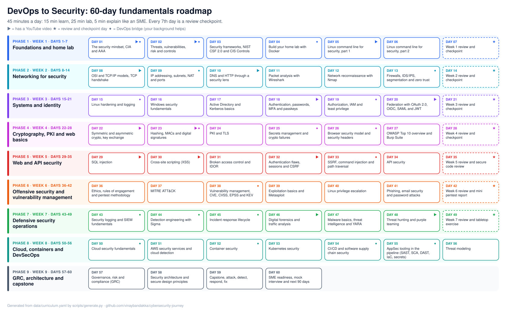

# Cybersecurity journey: DevOps to security in 60 days

A hands-on plan to master security fundamentals in 60 days at 45 minutes a day, built for someone coming from DevOps. Every day has a clear outcome, one or two hand-picked resources (including YouTube), a 25-minute lab, and a question to answer like a subject matter expert.



**Start here:** [ROADMAP.md](ROADMAP.md) → [Day 01](days/week-01/day-01-the-security-mindset-cia-and-aaa.md) → set up [tracking in Notion](tracker/NOTION_SETUP.md).

## How a day works

| 15 min: Learn | 25 min: Lab | 5 min: Explain |
|---|---|---|
| Watch or read one resource from the day page | Do the hands-on task and save the evidence | Answer the SME question out loud, then in writing |

Then commit your notes and update the day's row in Notion. Every seventh day is a review and checkpoint.

## The 9 phases

| Days | Phase | What you'll be able to do |
|---|---|---|
| 1-7 | Foundations and home lab | Speak the core vocabulary, reason about risk, run your own lab |
| 8-14 | Networking for security | Read packets, map networks, place every network control |
| 15-21 | Systems and identity | Harden Linux and Windows, explain AD, MFA, IAM, OAuth/OIDC |
| 22-28 | Cryptography, PKI and web basics | Use crypto correctly, debug TLS, manage secrets, drive Burp |
| 29-35 | Web and API security | Exploit and fix the OWASP Top 10 and API Top 10 in labs |
| 36-42 | Offensive security and vuln management | Run a scoped test, map to ATT&CK, prioritise with CVSS/EPSS/KEV |
| 43-49 | Defensive security operations | Write detections, run incident response, hunt threats |
| 50-56 | Cloud, containers and DevSecOps | Secure AWS, Docker, Kubernetes and CI/CD (your biggest edge) |
| 57-60 | GRC, architecture and capstone | Talk risk with leaders, design secure systems, prove it end to end |

## Why this works for a DevOps engineer

You already know Linux, networking, containers, CI/CD and cloud. Each day page has a **DevOps bridge** that ties the new concept to something you've built. Phase 8 is where you'll be ahead of most security people. Lean into it in interviews: security teams badly need people who can automate and who understand how engineers work.

## Repository layout

```
ROADMAP.md                 Full plan: phases, topics, outcomes, milestones, links to every day
assets/roadmap.svg         The one-page picture of all 60 days (regenerated with the plan)
PROGRESS.md                Git-native checklist of all 60 days
days/week-NN/day-NN-*.md   One page per day: outcome, learn, lab, SME question, deliverable
data/curriculum.yaml       Single source of truth for the plan (edit this, then regenerate)
labs/                      Docker lab, setup guide, write-up / pentest report / IR templates
notes/                     Your daily notes (start from notes/TEMPLATE.md)
detections/                Sigma and YARA rules you write
playbooks/                 Incident response playbooks you write
reports/                   Pentest report, threat model, architecture
capstone/                  The day-59 end-to-end exercise
sme/INTERVIEW_QUESTIONS.md How to answer like an expert, plus questions for every week
resources/RESOURCES.md     Courses, YouTube channels, books, news, certifications
tracker/                   Notion CSV, setup guide and sync script
scripts/                   Generator and link checker
```

## Quick start

```bash
git clone https://github.com/vinaybandakka/cybersecurity-journey.git
cd cybersecurity-journey
docker compose -f labs/docker-compose.yml up -d   # day 4 sets this up properly
cp notes/TEMPLATE.md notes/day-01.md
```

Change the start date or skip weekends:

```bash
pip install pyyaml requests
python3 scripts/generate.py --start 2026-11-16 --weekends-off
```

## Keeping links healthy

`.github/workflows/links.yml` checks every link on each push and every Monday. YouTube links are verified through YouTube's oEmbed API, so a deleted or private video is caught even though its page still loads. Run it locally with `python3 scripts/check_links.py --verbose`.

A few sites (Cloudflare Learning Center, TryHackMe, iso.org) block CI runners with bot protection. The checker reports those as `WARN` instead of failing, and they were checked by hand in a browser on 2026-11-08.

## Rules

Only test systems you own or have written permission to test: your lab, PortSwigger labs, TryHackMe machines, flAWS and `scanme.nmap.org`. Never commit real credentials, flags or customer data.
